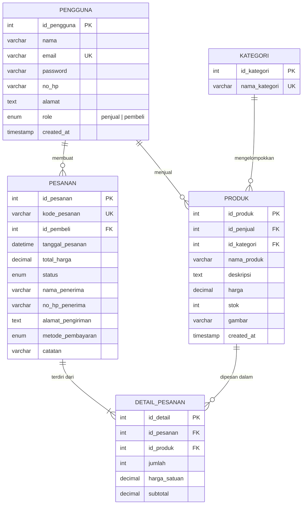
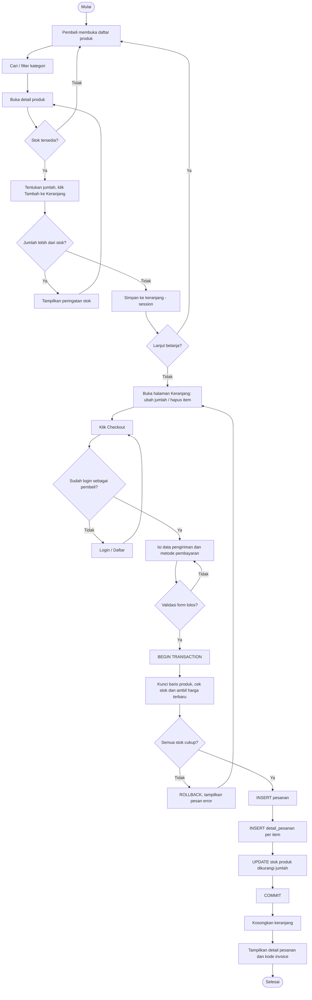

# Dokumen Perancangan Aplikasi Web Marketplace Tradisional (PasarKita)

Dokumen ini menjawab **Bagian A (Analisis dan Perancangan Sistem)** pada OAL 11.
Diagram memakai sintaks Mermaid, sehingga tampil otomatis di GitHub. Untuk laporan,
ambil screenshot diagram dari halaman GitHub atau tempel kode Mermaid ke https://mermaid.live.

---

## A.a Identifikasi Entitas

| No | Entitas | Peran dalam sistem |
|----|---------|--------------------|
| 1 | **Pengguna** | Akun yang login. Memiliki peran `penjual` atau `pembeli`. |
| 2 | **Kategori** | Pengelompokan produk (Sayur & Buah, Sembako, dan seterusnya). |
| 3 | **Produk** | Barang yang ditawarkan penjual: nama, harga, stok, gambar. |
| 4 | **Pesanan** | Header transaksi yang dibuat pembeli: kode, tanggal, total, status, data pengiriman. |
| 5 | **Detail Pesanan** | Rincian item dalam satu pesanan: produk, jumlah, harga satuan saat checkout, subtotal. |

Catatan desain:

- Penjual dan pembeli disatukan dalam satu entitas `pengguna` dengan atribut `role`, supaya tidak ada duplikasi data akun.
- Keranjang belanja disimpan di *session* PHP (sementara, sebelum checkout), sehingga tidak menjadi tabel. Data baru tersimpan permanen saat checkout menjadi `pesanan` dan `detail_pesanan`.
- `harga_satuan` disalin ke `detail_pesanan` agar riwayat transaksi tidak berubah ketika penjual mengubah harga produk di kemudian hari.

---

## A.b Rancangan Database Relasional

Engine InnoDB, charset `utf8mb4`. Skrip lengkap ada di `database/schema.sql`.

### Tabel `pengguna`

| Atribut | Tipe | Kunci | Keterangan |
|---------|------|-------|------------|
| id_pengguna | INT UNSIGNED, AUTO_INCREMENT | **PK** | |
| nama | VARCHAR(100) | | Nama lengkap atau nama toko |
| email | VARCHAR(150) | UNIQUE | Dipakai untuk login |
| password | VARCHAR(255) | | Hash `password_hash()`, bukan teks asli |
| no_hp | VARCHAR(20) | | |
| alamat | TEXT | | |
| role | ENUM('penjual','pembeli') | | |
| created_at | TIMESTAMP | | |

### Tabel `kategori`

| Atribut | Tipe | Kunci | Keterangan |
|---------|------|-------|------------|
| id_kategori | INT UNSIGNED, AUTO_INCREMENT | **PK** | |
| nama_kategori | VARCHAR(80) | UNIQUE | |

### Tabel `produk`

| Atribut | Tipe | Kunci | Keterangan |
|---------|------|-------|------------|
| id_produk | INT UNSIGNED, AUTO_INCREMENT | **PK** | |
| id_penjual | INT UNSIGNED | **FK** → pengguna.id_pengguna | ON DELETE CASCADE |
| id_kategori | INT UNSIGNED | **FK** → kategori.id_kategori | ON DELETE RESTRICT |
| nama_produk | VARCHAR(150) | | |
| deskripsi | TEXT | | |
| harga | DECIMAL(12,2) | | |
| stok | INT UNSIGNED | | |
| gambar | VARCHAR(255) | | Nama file di `assets/uploads/` |
| created_at | TIMESTAMP | | |

### Tabel `pesanan`

| Atribut | Tipe | Kunci | Keterangan |
|---------|------|-------|------------|
| id_pesanan | INT UNSIGNED, AUTO_INCREMENT | **PK** | |
| kode_pesanan | VARCHAR(20) | UNIQUE | Contoh: INV261112A1B2C3 |
| id_pembeli | INT UNSIGNED | **FK** → pengguna.id_pengguna | ON DELETE RESTRICT |
| tanggal_pesanan | DATETIME | | |
| total_harga | DECIMAL(14,2) | | |
| status | ENUM('menunggu','diproses','dikirim','selesai','dibatalkan') | | Default `menunggu` |
| nama_penerima | VARCHAR(100) | | |
| no_hp_penerima | VARCHAR(20) | | |
| alamat_pengiriman | TEXT | | |
| metode_pembayaran | ENUM('transfer','cod') | | |
| catatan | VARCHAR(255) | | Opsional |

### Tabel `detail_pesanan`

| Atribut | Tipe | Kunci | Keterangan |
|---------|------|-------|------------|
| id_detail | INT UNSIGNED, AUTO_INCREMENT | **PK** | |
| id_pesanan | INT UNSIGNED | **FK** → pesanan.id_pesanan | ON DELETE CASCADE |
| id_produk | INT UNSIGNED | **FK** → produk.id_produk | ON DELETE RESTRICT |
| jumlah | INT UNSIGNED | | |
| harga_satuan | DECIMAL(12,2) | | Harga saat checkout |
| subtotal | DECIMAL(14,2) | | jumlah × harga_satuan |

### Hubungan antar-tabel

| Relasi | Kardinalitas | Penjelasan |
|--------|--------------|------------|
| pengguna (penjual) – produk | 1 : N | Satu penjual memiliki banyak produk; satu produk dimiliki satu penjual. |
| kategori – produk | 1 : N | Satu kategori berisi banyak produk. |
| pengguna (pembeli) – pesanan | 1 : N | Satu pembeli dapat membuat banyak pesanan. |
| pesanan – detail_pesanan | 1 : N | Satu pesanan terdiri dari satu atau lebih item. |
| produk – detail_pesanan | 1 : N | Satu produk dapat muncul di banyak detail pesanan. |
| pesanan – produk | M : N | Diselesaikan lewat tabel penghubung `detail_pesanan`. |

Aturan integritas: produk yang sudah pernah dipesan tidak dapat dihapus (`ON DELETE RESTRICT`), agar riwayat transaksi tetap utuh. Penjual cukup mengubah stok menjadi 0.

---

## A.c ERD (Entity Relationship Diagram)



---

## A.d Alur Proses Transaksi

Dari pembeli memilih produk sampai pesanan tersimpan:



Alasan memakai transaksi: tiga langkah (simpan pesanan, simpan detail, kurangi stok) harus berhasil bersamaan. Bila salah satu gagal, `ROLLBACK` membatalkan semuanya sehingga tidak ada pesanan setengah jadi. `SELECT ... FOR UPDATE` mencegah dua pembeli memesan stok terakhir secara bersamaan.

Setelah pesanan dibuat, penjual melihatnya di menu **Pesanan Masuk** dan mengubah status: menunggu → diproses → dikirim → selesai (atau dibatalkan).

---

## A.e Rancangan Antarmuka (Mockup UI)

Wireframe interaktif berbasis Bootstrap ada di **`docs/mockup.html`** (buka di browser, lalu screenshot tiap bagian untuk laporan). Sketsa ringkasnya:

### 1. Daftar Produk

```
+--------------------------------------------------------------------+
| PasarKita   Produk  Kelola Produk       Keranjang(2)  Masuk [Daftar]|
+--------------------------------------------------------------------+
|  +--------------------------------------------------------------+  |
|  |  Belanja Produk Lokal, Langsung dari Penjualnya              |  |
|  |  [ Cari produk...            ] [ Semua kategori v ] [ Cari ] |  |
|  +--------------------------------------------------------------+  |
|  Produk (8 ditemukan)                                [Reset filter]|
|  +----------+  +----------+  +----------+  +----------+            |
|  | [gambar] |  | [gambar] |  | [gambar] |  | [gambar] |            |
|  | Kategori |  | Kategori |  | Kategori |  | Kategori |            |
|  | Nama     |  | Nama     |  | Nama     |  | Nama     |            |
|  | Rp 25.000|  | Rp 12.000|  | Rp 72.000|  | Rp 36.000|            |
|  | Penjual  |  | Penjual  |  | Penjual  |  | Penjual  |            |
|  |[+Keranjg]|  |[+Keranjg]|  |[+Keranjg]|  |[Habis]   |            |
|  +----------+  +----------+  +----------+  +----------+            |
|                      « 1 2 3 »                                     |
+--------------------------------------------------------------------+
```

### 2. Detail Produk

```
+--------------------------------------------------------------------+
| Produk > Sayur & Buah > Cabai Merah Keriting 500 gr                |
|  +---------------------------+   [Sayur & Buah]                    |
|  |                           |   Cabai Merah Keriting 500 gr       |
|  |        [ gambar ]         |   Rp 25.000                         |
|  |                           |   Stok     : 40 tersedia            |
|  +---------------------------+   Penjual  : Toko Sumber Rejeki     |
|                                  Lokasi   : Pasar Minggu           |
|                                  Deskripsi: Cabai segar petani...  |
|                                  [ 1 ] [Tambah ke Keranjang]       |
|                                        [Lanjut belanja]            |
+--------------------------------------------------------------------+
```

### 3. Keranjang Belanja

```
+--------------------------------------------------------------------+
| Keranjang Belanja                                                  |
| +------------------------------------------+ +-------------------+ |
| | Produk          Harga     Jumlah  Subtotal| | Ringkasan Belanja | |
| | [img] Cabai     25.000   [2][⟳]  50.000 🗑| | Total item     3  | |
| | [img] Tomat     12.000   [1][⟳]  12.000 🗑| | Total harga       | |
| +------------------------------------------+ |        Rp 62.000  | |
| Kosongkan keranjang                          | [   Checkout    ] | |
|                                              | [Lanjut belanja ] | |
|                                              +-------------------+ |
+--------------------------------------------------------------------+
```

---

## Ringkasan Fitur yang Diimplementasikan

| Kebutuhan OAL | Berkas |
|---------------|--------|
| Daftar produk (cari, filter, pagination) | `index.php` |
| Detail produk | `detail.php` |
| CRUD produk | `produk/index.php` (Read), `produk/form.php` (Create & Update), `produk/hapus.php` (Delete) |
| Keranjang belanja | `cart.php` |
| Simpan transaksi ke database | `checkout.php` (transaksi MySQLi), `pesanan.php` (riwayat) |
| Login, registrasi, peran | `login.php`, `register.php`, `logout.php` |
| Pesanan masuk untuk penjual | `produk/pesanan_masuk.php` |

Keamanan yang diterapkan: *prepared statement* MySQLi di semua query, `password_hash`, token CSRF di semua form POST, escaping output (`htmlspecialchars`), validasi tipe dan ukuran file upload, pengecekan kepemilikan produk pada edit/hapus, dan kredensial database di luar repository.
